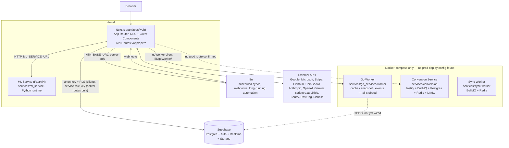
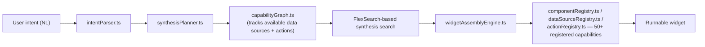

# WebWidgets Architecture

This is the canonical, root-level architecture reference for coding agents
and humans working on WebWidgets. It supersedes and absorbs the former
`docs/blueprint/ARCHITECTURE.md` (now a pointer to this file). It describes
what actually exists in the codebase today, not the aspirational end state —
see [ROADMAP.md](ROADMAP.md) for maturity ratings and what's still ahead.

**Codebase size (last measured May 2026):** 1,446 TypeScript/TSX files, ~221k
lines. Treat as directionally correct, not current to the day.

---

## 1. Overview

WebWidgets ("Dashboard" in the README) is a personal-productivity web app: a
customizable widget dashboard backed by Next.js (App Router) and Supabase,
with a Python ML sidecar, a Go background worker, and a standalone file
conversion service. It is **not** an npm workspace monorepo — `apps/web` and
each `services/*` directory are independently managed (own `node_modules`,
own lockfile where present), invoked from the root via `cd` in npm scripts.
`turbo.json` exists but is only lightly used (build/dev/lint/test task
definitions, no remote caching configured).

```
apps/web/             Next.js 16 App Router app (`next: ^16.2.3` in package.json) — the product surface
services/ml_service/  Python FastAPI — classification, suggestions, extraction
services/sync-worker/ Node/TS V1 worker — BullMQ runtime, health, persisted jobs
services/conversion/  Standalone file-conversion pipeline (own npm workspace:
                       fastify API + BullMQ worker + Postgres + Redis + MinIO)
services/go_services/worker/  Go worker — cache/snapshot/event infra (STUBBED, §9)
packages/{config,shared,ui}/  Empty placeholder packages (package.json only,
                       no source, not wired into any build — do not assume
                       code here compiles or is imported by anything)
supabase/migrations/  52 reviewed migrations aligned with webwidgets-dev
infra/                Vercel/Docker/Procfile deployment config
scripts/linting/      Custom lint/typecheck/smell/stats orchestrator (`npm run check`)
```

---

## 2. Service topology



**What's actually deployed today:** `apps/web` → Vercel (Next.js, 3 cron jobs
for Gmail/Outlook processing — see `vercel.json`).
`services/ml_service` → Vercel Python serverless (`infra/vercel.json` +
service-level `vercel.json`), **or** a Procfile-based host
(`infra/Procfile`) — the two deploy targets are not reconciled in the repo;
confirm which is authoritative before relying on either.
`services/sync-worker` is deployed through `render.yaml`. During finalization
it uses a free web-service compatibility deployment plus free, non-persistent
Key Value and has passed readiness, heartbeat, and idempotent runtime probes;
the paid continuous worker and persistent queue remain the production upgrade
target. `services/conversion` and `services/go_services/worker` still have no
supported production path.

### Accepted V1 ownership target

ADR-008 through ADR-014 define the accepted target. The worker runtime and
manifest are implemented, but this is not a claim that Render is provisioned:

- `services/sync-worker` becomes the one continuously running V1
  TypeScript/BullMQ worker for polling, normalization, analysis schedules,
  actions, retries, dead letters, and health.
- Supabase Postgres owns durable lifecycle truth. BullMQ/Redis owns delivery,
  concurrency, retry timing, and delayed schedules only.
- Next.js owns authenticated UI/API, webhook validation, source configuration,
  queries, and exact-payload approval boundaries.
- Python performs bounded stateless inference through the authenticated
  `webwidgets-v1-inference` Render container. Anthropic is the only V1 external
  adapter; Next.js enforces paid-tier and consent policy before calling it.
  n8n is an optional approved
  workflow executor. The Go worker is disabled and deferred for V1.
- Vercel crons remain temporary cutover fallbacks and must not run a schedule
  also owned by the worker.
- Render is the selected worker host. The finalization deployment uses a free
  web-service compatibility process and non-persistent `noeviction` Key Value;
  production upgrades to a continuously running background worker and
  persistent queue. The first deployment is dark and provider work remains
  off.

The complete lifecycle, responsibility matrices, retention policy, and
migration sequence are in
[`docs/finalization/OWNERSHIP_PROPOSAL.md`](docs/finalization/OWNERSHIP_PROPOSAL.md).

---

## 3. Frontend structure and feature catalog

```
apps/web/
  app/          Next.js App Router pages + API routes (/app/api/**)
  features/     65+ self-contained feature modules — components/, lib/,
                api/, types/, hooks/, constants.ts
  lib/          Shared, cross-feature code only
    supabase/       Server/admin/browser Supabase clients — ~215 files import
                     from here, the single highest fan-in path in the codebase
    observability/  Logger, Sentry, PostHog — ~40 importers
    connectors/     Google, Microsoft, GitHub, Linear, Slack OAuth connectors
    goWorker/       Go worker client
    n8n/            n8n client, webhook verification, schemas
    aws/            S3 client + presigned URL helpers
    playwright/     Browser automation (form filler)
    stripe/         Stripe client
    widget-tools/   Shared computation helpers (finance, tracking, viz, time)
  icons/        SVG icon components (no inline SVG allowed elsewhere)
```

**Dependency direction rule (ADR-004):** `features/<x>/` never imports from
`features/<y>/`. Shared code goes in `lib/`. Some utility duplication across
features is an accepted tradeoff — extract to `lib/` only once a pattern
repeats in 3+ features. This is the load-bearing rule that keeps feature
modules safe to assign to different agents in parallel — see §11 and
AGENTS.md.

`lib/supabase/` and `features/dashboard/types/dashboard.ts` (the `WidgetType`
union, ~60 importers) are the two highest-risk single points of contention —
any task that touches either should be flagged high-risk and scoped
narrowly.

### Feature module reference

Each feature is self-contained: hooks, components, types, and services live
together. This is the full current catalog, grouped by domain. (For each
feature's user-facing scope/goals rather than its code shape, see
[docs/blueprint/FEATURE_LIST.md](docs/blueprint/FEATURE_LIST.md) — that file
tracks ~90 named product-feature domains, including 4 explicitly tagged
`#future-feature` and not yet started: `food-delivery`, `screen-viewer`,
`live-resume`, `personal-documents`.)

| Feature           | Purpose                                                                                                |
| ----------------- | ------------------------------------------------------------------------------------------------------ |
| `accessibility`   | Accessibility center widget + settings page                                                            |
| `actions`         | Action engine — extract, queue, execute email/calendar actions                                         |
| `activity`        | Activity feed                                                                                          |
| `admin`           | Admin panel (users, flags, audit, metrics, ML, jobs)                                                   |
| `analytics`       | PostHog event tracking                                                                                 |
| `artifacts`       | Artifact storage (DB table + API + components intact; standalone route removed, now a tab in `/files`) |
| `auth`            | Supabase Auth, Google OAuth, sign-in form                                                              |
| `automation`      | Automation evaluator + registry                                                                        |
| `backend`         | Shared request utilities (requestUser, service registry)                                               |
| `billing`         | Stripe plans, checkout, PricingCard, BillingCard                                                       |
| `calculator`      | Multi-mode calculator (basic, scientific, programmer, financial, datetime)                             |
| `calendar`        | Google Calendar integration (events, EventFormModal)                                                   |
| `chatbot`         | Multi-model AI chat (Claude, GPT-4o, Gemini)                                                           |
| `chess`           | Games library, analysis board, studies, move trainer                                                   |
| `collaboration`   | Collaborative workspace widget and page                                                                |
| `context`         | Context graph — knowledge nodes, AI memory, permissions (§6)                                           |
| `convert`         | Unit + currency converter widget                                                                       |
| `countdown`       | Event countdown widget                                                                                 |
| `creative`        | Creative studio widget and page                                                                        |
| `currency`        | Exchange rate widget (Open Exchange Rates)                                                             |
| `dashboard`       | Widget grid, free canvas, drag-and-drop, scenes, folders, runtime scheduler                            |
| `developer`       | Developer tools page                                                                                   |
| `feedback`        | In-product user feedback                                                                               |
| `files`           | File format conversion registry and service                                                            |
| `finance`         | Net worth, accounts, subscriptions, transactions, watchlist                                            |
| `form-filler`     | Playwright-powered form autofill                                                                       |
| `habit`           | Habit tracker with streaks                                                                             |
| `help`            | In-product help system                                                                                 |
| `import-export`   | Data import/export pipeline                                                                            |
| `inbox`           | Gmail integration, ML email classification, action extraction                                          |
| `integrations`    | Integration catalog cards                                                                              |
| `intelligence`    | ML inference service, smart recommendations                                                            |
| `jobs`            | Background job runner + service                                                                        |
| `journal`         | TipTap rich-text journal (autosave, transcription)                                                     |
| `knowledge`       | Knowledge item registry (distinct from `context` — see §11)                                            |
| `memorization`    | Memorization widget and page                                                                           |
| `metrics`         | Internal metrics dashboard                                                                             |
| `mood`            | Mood logging widget                                                                                    |
| `news`            | News Intel — RSS/NewsAPI ingestion, ranking, search                                                    |
| `notifications`   | Notification bell, status dot                                                                          |
| `onboarding`      | Multi-step onboarding flow (goals, integrations, workspace gen)                                        |
| `personalization` | Personalization service                                                                                |
| `platform`        | Widget registry, dashboard library, platform persistence                                               |
| `pomodoro`        | Pomodoro / focus timer                                                                                 |
| `privacy`         | Privacy policy, terms pages                                                                            |
| `reading`         | Reading platform — Bible, Quran, PDFs, provider abstraction                                            |
| `recovery`        | Addiction recovery trackers (heatmap, milestones, review)                                              |
| `research`        | Research queue widget and workspace (Obsidian vault, academic pipeline)                                |
| `scratchpad`      | Quick-note scratchpad                                                                                  |
| `search`          | Global search bar + widget catalog                                                                     |
| `security`        | Consent records + security page                                                                        |
| `settings`        | General, profile, appearance, integrations, plan & billing                                             |
| `texteditor`      | TipTap-based text editor + note manager                                                                |
| `timekeeping`     | Timer / stopwatch / event countdown widget                                                             |
| `todo`            | To-do list + habit section                                                                             |
| `tracking`        | Health tracking — sleep, workout, meal, mood, supplements                                              |
| `tutorials`       | In-product tutorials widget                                                                            |
| `ui`              | Shared UI (Header, Footer, DatePicker, LoadingState)                                                   |
| `uploads`         | S3 file uploads + Google Drive browser                                                                 |
| `view`            | File viewer (CSV, PDF, image, JSON parsers)                                                            |
| `weather`         | Open-Meteo weather widget                                                                              |
| `widget-builder`  | Widget builder UI                                                                                      |
| `widgets`         | Widget shell, settings panel, synthesis engine (§4)                                                    |
| `workflows`       | n8n workflow trigger service                                                                           |
| `worldclock`      | World clock (analog + digital) widget                                                                  |

**10 pages currently have zero internal navigation links pointing to them**
(per `docs/PAGE_REFERENCES.md`): `/personalization`, `/documents`,
`/documents/[id]`, `/chess/[id]`, `/chess/studies/[studyId]`,
`/collaboration/invite/[token]`, `/datahealth`, `/import-export`, plus
`/metrics` (expected — sidebar skips to `/metrics/overview`) and
`/auth/auth-code-error` (expected — error-only page). The first eight are
candidates for a "built but orphaned" audit rather than assumed-working
surfaces.

---

## 4. Widget system

Widgets are the core UI unit. Registering a new widget type is **not a
single-file change** — it touches at least 4 files across ~6 edit sites, all
of which are common ground for concurrent work and a near-guaranteed
merge-conflict source if two agents add widgets in the same window:

1. `apps/web/features/dashboard/types/dashboard.ts` — `WidgetType` union
   (flat string-literal union, ~50 entries, one contiguous block)
2. `apps/web/features/dashboard/lib/renderWidgetContent.tsx` — lazy
   `import()` declaration + a `switch` statement, one `case` per widget type
   (14 prior commits of churn — the single hottest file in this pipeline)
3. `apps/web/features/platform/lib/dashboardWidgetLibrary.ts` — **two**
   separate arrays (`RENDERABLE_WIDGET_TYPES` and `WIDGET_COMPLEXITY_ORDER`),
   both need a new entry
4. `apps/web/features/search/lib/widgetCatalog.ts` — thin re-export over 4
   sharded files (`widgetCatalogPart1.ts`–`Part4.ts`); no documented
   convention for which part file a new entry belongs in

Currently 46 renderable widget types: `texteditor`, `journal`, `notes`,
`scratchpad`, `email`, `recovery`, `recovery-empty`, `converter`, `currency`,
`calculator`, `chess`, `timekeeping`, `timer`, `stopwatch`, `pomodoro`,
`countdown`, `todo`, `habit`, `weather`, `worldclock`, `mood`, `calendar`,
`form-filler`, `tracking`, `tracking-sleep`, `tracking-workout`,
`tracking-meal`, `tracking-mood`, `tracking-supplements`, `tracking-health`,
`context-diagram`, `chat`, `finance`, `news`, `widget-builder`, `files`,
`view`, `folder`, `reading`, `research-queue`, `collaboration`,
`accessibility`, `memorization`, `creative`, `insight-cards`, `automation`,
`developer`.

**Widget Synthesis Engine** (`features/widgets/synthesis/`, ~113 importers of
`features/widgets/` overall — the second-highest fan-in path in the repo):
builds custom widgets from declarative user intent.



**Dashboard Runtime** (`features/dashboard/`, config in
`dashboardRuntimeConfig.ts`): a hydration scheduler for widgets — burst +
staggered batches, 4-level visibility via `IntersectionObserver` (3 observers
per widget — a known perf cost), 3-tier pressure/adaptive throttling, fetch
dedupe/cooldown/backoff, dev-only `RuntimeInspector`. Self-documented known
limitations: snapshot preview extraction is generic/non-widget-specific,
pressure thresholds are empirically tuned rather than derived, no idle-time
hydration yet.

**View widget** (`features/view/`): a full parse → normalize → render →
analyze → edit → transform → export pipeline for
PDF/text/markdown/code/CSV/JSON/YAML/images/SVG, with its own
annotation/layer/canvas/export subsystems. Registered via
`parserRegistry.ts` / `rendererRegistry.ts`.

---

## 5. Widget data orchestration

The direction of travel (per
`docs/agents/completions/widget-data-orchestration.md`) is away from
per-widget fetching and toward centralized screen snapshots:

```
Client (widget) → hooks → snapshot API routes → screen orchestrators
  → widget manifest / data-resolver registry → domain services
  → connectors / DB / external APIs / ML service
```

Not every widget has migrated to this pattern yet — check the specific
feature before assuming snapshot-based fetching is in place.

### Confirmed data flows

**Email actions:**

```
Gmail API → /api/gmail/inbox (fetch + classify via ML service)
  → /api/gmail/extract-actions (extract actions via ML service)
  → email_actions table (store results)
  → /api/gmail/actions/confirm (create Calendar events / Todos)
```

**Canonical provider timeline (Prompt 007 cutover path):**

```
Google/Microsoft OAuth → user_email_accounts (server-only credentials)
  → integration_connections (identity, cursor, schedule, source health)
  → V1 worker provider.sync
  → raw_observations → timeline_events
  → email_snapshots / email_queue (temporary inbox-action projection)
```

Gmail push validates the webhook and marks the canonical connection due; it
does not become a second cursor or source-health owner. Google Calendar uses
its incremental sync token. Outlook Mail uses Microsoft Graph delta links.
Outlook Calendar is deferred until the authorization flow explicitly requests
and verifies a least-privilege calendar scope. Provider polling is active on
the Render worker through `PROVIDER_SYNC_ENABLED`; canonical job leases recover
work interrupted by a deployment restart.

**Canonical internal timeline (Prompt 008):**

```
todos / journals / documents / artifacts / parse outcomes
  → content-minimizing database projection triggers
  → raw_observations → timeline_events
selected activity outcomes → same projection (unless origin=timeline_projection)
```

Domain rows remain source truth. The projection is forward-only and versioned;
content-only note/document autosaves are coalesced into 15-minute windows.
Timeline payloads contain source references and change metadata, not note or
document bodies. Deleting a source retracts its prior facts, clears retained
raw payloads, and leaves a minimal tombstone event.

**Timeline Intelligence read path (Prompt 009):**

```
News page/widget → authenticated /api/news/feed
  → owner-scoped timeline_events (stable cursor pagination)
  + integration_connections (independently recoverable health)
```

The API reads canonical persistence and never contacts providers during page
render. It orders by occurrence time and UUID, exposes ingestion time when
collection was delayed, and returns bounded text plus HTTP(S) provenance.
Related-story keys remain inspectable links rather than destructive merges.

**Evidence-backed intelligence and task execution (Prompts 011–013):**

```
timeline_events → deterministic bounded ranking/extraction
  → governed inference only for supported ambiguity
  → briefings → briefing_items → briefing_item_evidence
  → insights → candidate_actions → candidate_action_evidence
  → exact-version candidate review
  → approved action_requests → durable action.execute job
  → atomic todos mutation → verified action_results
```

Briefings are expiring derived aggregates, never timeline facts. Every briefing
item and commitment candidate keeps direct owner-matched evidence. Daily and
on-demand briefings share one durable `briefing.generate` job. Commitment
candidates use deterministic rules for clear dated requests and the governed
`commitment_candidates` model contract only for bounded ambiguity. Editing a
candidate increments its payload version and clears approval. Approval binds
the current hash/version; task candidates then materialize one canonical
request. The worker carries only its ID, while Supabase atomically validates,
mutates, verifies, and receipts the task. Calendar candidates still stop at
review until Prompt 014.

Calendar events with midnight UTC use all-day `date` format, not `dateTime`,
to prevent wrong-day display in non-UTC timezones (ADR-003).

**Reading platform:**

```
Client (ReadingWidget) → bootstrapProviders() (register mock + real providers)
  → provider.listDocuments() → provider.getContent(pos)
  → /api/reading/bible (scripture.api.bible proxy, server-side key)
  → /api/reading/pdf-url (S3 GetObject presigned URL, 1h expiry, cached 55m)
  → /api/reading/{bookmarks,highlights,notes,progress} (annotations CRUD)
```

**Finance:**

```
Client (FinanceWidget) → /api/finance/accounts (manual balances, Supabase)
  → /api/finance/watchlist/[id]/fetch (live quotes: Finnhub stocks,
    CoinGecko crypto, Zillow/Attom real-estate stub)
  → /api/finance/subscriptions, /api/finance/transactions (Supabase)
```

---

## 6. Context / knowledge system

`features/context/` (~37 importers) is the context graph — knowledge nodes,
AI memory, and permissions. Backed by the single tracked Supabase migration
in the repo, `202605300001_context_substrate.sql`. This is the newest major
subsystem and the one most likely to still be evolving; treat changes here as
higher-risk/needs-care by default.

`features/knowledge/` is a separate, smaller knowledge item registry and owns
user-authored notes, journals, drafts, transcripts, and research content.
The context graph is a rebuildable entity/retrieval projection for search,
widgets, and models. It is not source truth and cannot outlive its referenced
domain or knowledge record (ADR-009).

The normalized V1 timeline owns meaningful user-scoped facts and provenance.
`activity_events` remains a recent-activity/notification projection. Domain,
knowledge, timeline, and verified outcome records may project one way into
activity and context; those projections must not republish themselves as new
timeline facts.

---

## 7. ML service architecture

```
services/ml_service/
  main.py               FastAPI app, prediction endpoints
  model_registry.py      Model versioning + A/B routing
  drift_monitor.py       Input distribution drift detection
  observability.py       Structured logging + metrics
  schemas.py              Pydantic request/response schemas
  training_utils.py       TF-IDF + LogReg training helpers
  train_*.py (10 files)    Per-domain training scripts (news ranker, health
                            trend, document classifier, task priority,
                            finance anomaly, memory card quality, action
                            extractor, action detector, chat intent, widgets)
  tests/                  pytest suite (4 test files: model_registry,
                           schemas, api, drift_monitor)
```

**Classification pipeline (ADR-002):** an ML model classifies intent/type
(WHAT to do); regex/heuristics extract structured fields (HOW — dates,
amounts, service names) as a separate post-classification step. Adding a new
action type requires both a new model class + training data AND a new
extraction helper — scope these as one task, not split across two agents.

**Model policy (ADR-001, ADR-006):** in-house TF-IDF + Logistic Regression
(scikit-learn **pinned to 1.4.2** — even patch mismatches break pickled
models) runs for all users; Claude is a fallback for paid-tier only, for cost
and latency control. Action-confidence threshold is **0.35** (ADR-007,
lowered from 0.45 after legitimate low-confidence emails were being dropped;
the `ignore` class is the safety net that makes this safe). Action classes
(7): `trial_end`, `payment_due`, `meeting`, `verification_needed`,
`reply_required`, `deadline`, `ignore`.

Email intelligence specifically is a 3-tier hybrid chain: deterministic rules
(`features/inbox/lib/rules.ts`) → internal ML service (`mlService.ts`) →
optional Anthropic fallback (`modelRouter.ts`).

For V1 deployment ownership, Python exposes bounded, versioned, stateless
inference only. It does not own schedules, queues, authorization policy,
canonical product state, or provider actions (ADR-011). The supported Render
container exposes only authenticated `/v1/ready` and `/v1/inference` routes.
Next.js records content-free audit/cost events and rejects free-tier or
unconsented external requests before source data crosses that boundary.

---

## 8. Persistence

Supabase Postgres, with Row-Level Security intended on all user-owned tables.
The read-only 2026-08-13 audit of confirmed project `webwidgets-dev` found 107
live `public` tables, 105 with RLS enabled, and 153 policies. Two child-log
tables (`export_job_logs`, `import_job_logs`) have RLS disabled despite grants
to anonymous/authenticated roles; `user_feedback` has RLS enabled with no
policy. See the
[full schema/RLS audit](docs/finalization/audits/2026-08-13-webwidgets-dev-schema-and-rls-audit.md).

The repository contains the 46 reviewed historical migrations recorded by
remote history plus fifteen reviewed successors. ADR-012's recovered-history
baseline completed on 2026-08-14; two identity-bearing historical files were
sanitized intentionally. On 2026-08-14, an owner-approved CLI deployment
applied the context, job-log security, lifecycle, retention, and approval
successors to `webwidgets-dev`. Local and remote history align at 61 versions.

Key tables include `profiles`, `dashboard_layouts`, `widget_settings`,
`widget_folders`, `email_actions`, `email_queue`, `todos`, `habits`,
`chess_positions`, `chess_study_chapters`, `recovery_trackers`,
`recovery_events`, `mood_logs`, `journal_entries`, `tracking_entries`,
`tracking_goals`, `supplement_definitions`, `countdown_events`,
`currency_rates`, `file_uploads`, `finance_accounts`,
`finance_subscriptions`, `finance_transactions`, `watchlist_items`,
`context_entries`, `chat_conversations`, `user_tokens`,
`user_integration_keys`, `billing_subscriptions`, `audit_logs`,
`feature_flags`, `background_jobs`, `consent_records`, `reading_documents`,
`reading_positions`, `reading_bookmarks`, `reading_highlights`,
`reading_notes`, `reading_plans`. This historical list is not exhaustive; the
audit inventory is the canonical dated snapshot for planning Prompt 004.

The committed Supabase types are regenerated directly from the deployed
`public,graphql_public` schemas after tracked migrations align. Historical
application drift remains a feature-level concern where callers reference
tables that do not exist live; generated types must remain mechanical and
must not be hand-edited to disguise such drift.

Prompt 004 now defines the repository target in six ordered local successors.
The new canonical chain is `raw_observations` -> `timeline_events` ->
`insights`/`insight_timeline_events` -> `candidate_actions` -> the existing
`action_requests`/`action_results` ledgers. Composite owner foreign keys and
RLS protect every new relation. `jobs`, `automation_runs`, and
`integration_connections` are evolved in place. See
`docs/finalization/CANONICAL_V1_SCHEMA.md`. These migrations replay cleanly
locally, are deployed to `webwidgets-dev`, and are represented by the
committed live-generated type file.

Briefings form a parallel derived aggregate in `briefings`, `briefing_items`,
`briefing_item_evidence`, and `briefing_feedback`. Commitment review extends
the action chain with direct `candidate_action_evidence`, append-only
`candidate_action_reviews`, and atomic edit/review functions that enforce an
exact payload version and hash.
Task execution extends that chain with a unique product receipt on `todos`, a
durable `action.execute` job, exact approval revalidation, optimistic update
checks, verified outcomes, and bounded compensation.

Admin/service-role Supabase access is restricted to `/app/api/**` server
routes and the dedicated server-only V1 worker (ADR-005 as amended by
ADR-008). Worker operations must carry explicit user scope and validate the
owning connection or record. The service role bypasses RLS entirely, so any
client-side or shared client-safe exposure is a full data-access-control
failure, not a bug. All client-side reads go through the anon key and RLS
policies.

Supabase is the accepted durable truth for source cursors/health, timeline,
jobs, approvals, action outcomes, automation state, and audit. BullMQ/Redis is
at-least-once delivery only; every queue job references a canonical record and
deterministic idempotency key (ADR-010). The target data model is implemented,
verified, deployed, and represented in generated types. Production connector
automation remains blocked on credential isolation and a reviewed worker
deployment.

Credential isolation is also unresolved: owner-readable policies protect
cross-user access but allow authenticated browser sessions to select raw
credential columns from `profiles`, `user_tokens`, `user_email_accounts`, and
`user_integration_keys`. V1 must move these behind a server-only credential
boundary before connector automation is considered secure.

---

## 9. Background jobs / infrastructure

- **Current state:** `services/sync-worker` starts four V1 consumers from one
  entrypoint, persists canonical `jobs` transitions, provides readiness,
  heartbeat, retry/dead-letter, timeout, and graceful shutdown behavior, and
  is deployed on Render for finalization. RSS/Atom is the first provider
  processor: authenticated Next.js routes configure sources while the worker
  owns network-safe fetches, schedules, normalization, canonical persistence,
  and health. The free service may sleep, so continuous production operation
  is not yet confirmed.
  The analysis queue also owns daily and on-demand briefing generation through
  an authenticated callback to Next.js. Commitment candidate generation stays
  at the authenticated Next.js policy boundary. Approved task candidates use
  the action queue and a service-only atomic Supabase executor; provider and
  workflow actions remain Prompt 014 work.
- **Accepted V1 owner:** extend `services/sync-worker` into the one durable
  TypeScript/BullMQ runtime. n8n is only an optional executor for explicitly
  configured, validated, approved workflows; it is not the ingestion owner,
  scheduler of record, approval state machine, or canonical run database.
- **Go worker** (`services/go_services/worker/`) — cache, snapshot, and event
  subsystems. **All three are currently stub implementations**: `cache.go`,
  `snapshot.go`, and `events.go` each carry an identical `// TODO: In future
phases, this will...` marker at the same line — cache writes, snapshot
  persistence, and event durability are all effectively no-ops today. Do not
  build features that depend on the Go worker actually persisting anything
  without first verifying (or implementing) the backing store.
- **Conversion service** (`services/conversion/`) — fastify API + BullMQ
  worker + Postgres + Redis + MinIO, its own docker-compose stack, own
  migrations directory (`infra/docker/initdb/`, separate database from the
  main Supabase project). Self-documented, duplicated-in-3-places gap: HTML
  input to the conversion pipeline is **not sanitized** before processing
  (`conversionMatrix.ts` exists near-identically in both `apps/web` and
  `services/conversion`, plus a third TODO in
  `spreadsheetProcessor.ts` — these copies can drift; changes to the
  sanitizer gap should update all three).

---

## 10. Authentication / authorization

- Supabase Auth (email + Google OAuth) is the identity provider.
- Google OAuth additionally scopes Gmail/Calendar/Drive access; Microsoft
  OAuth (`lib/connectors/microsoft/graphConnector.ts`) scopes
  Outlook/OneDrive.
- Tokens live in `user_tokens`, refreshed via `@supabase/ssr`.
- Server Components use cookie-based sessions; Client Components use
  `createBrowserClient`.
- Admin access is DB-driven (`admin_role` table), checked via
  `lib/supabase/requireAdmin.ts` — not a hardcoded allowlist.
- Security posture overall is closer to "scoped checklist" than "implemented
  and verified" — `docs/blueprint/SECURITY.md` is a TODO list (auth
  boundaries, token storage, permission scopes, RLS, secrets, rate limiting,
  audit logging, consent, deletion, automation safety, RBAC, input
  sanitization, abuse prevention), and the product's own staging plan
  (`docs/blueprint/VISION.md`) places "Security" as stage 7 of 8. Treat
  security claims elsewhere in the docs as unverified until you've checked
  the actual code path — see ROADMAP.md.

### Integrations

| Provider            | Method  | Notes                                      |
| ------------------- | ------- | ------------------------------------------ |
| Google              | OAuth   | Gmail, Calendar, Drive                     |
| Microsoft           | OAuth   | Outlook, OneDrive via Graph API            |
| GitHub              | OAuth   | `lib/connectors/github/githubConnector.ts` |
| Linear              | API key | `lib/connectors/linear/linearConnector.ts` |
| Slack               | OAuth   | `lib/connectors/slack/slackConnector.ts`   |
| Stripe              | Webhook | Billing, checkout, portal                  |
| AWS S3              | SDK     | File uploads, PDF presigned URLs           |
| n8n                 | Webhook | Workflow automation triggers               |
| Lichess             | API key | Chess game import                          |
| Finnhub             | API key | Stock quotes                               |
| CoinGecko           | API key | Crypto quotes                              |
| Anthropic           | API key | Claude (chat + email fallback)             |
| OpenAI              | API key | GPT-4o (chat)                              |
| Gemini              | API key | Gemini (chat)                              |
| scripture.api.bible | API key | Religious text provider (server proxy)     |
| Sentry              | DSN     | Error tracking (client + server + edge)    |
| PostHog             | API key | Product analytics                          |

---

## 11. Known architectural ambiguities

These are unresolved boundary questions flagged by prior agent work
(`docs/agents/issues/PROBLEMS.md`) or found during this audit. Do not
silently pick an interpretation when working in these areas — ask, or scope
the task narrower to avoid guessing:

- **Legacy runtime cutover** — widget hydration remains client-side, the Go
  worker is deferred, n8n is an adapter, and the TypeScript worker owns V1
  background work. The source-by-source order for retiring duplicate Vercel
  cron and provider-processing paths still requires implementation evidence.
- **`docs/blueprint/CURRENT_STATE.md`, `docs/blueprint/DEPLOYMENT.md`, and
  `docs/blueprint/AUTOMATION_GUIDE.md` are empty files.** Treat any claim
  that depends on them as unverified — `docs/blueprint/CURRENT_STATE.md` now
  points to [ROADMAP.md](ROADMAP.md), which is the real maturity assessment.
