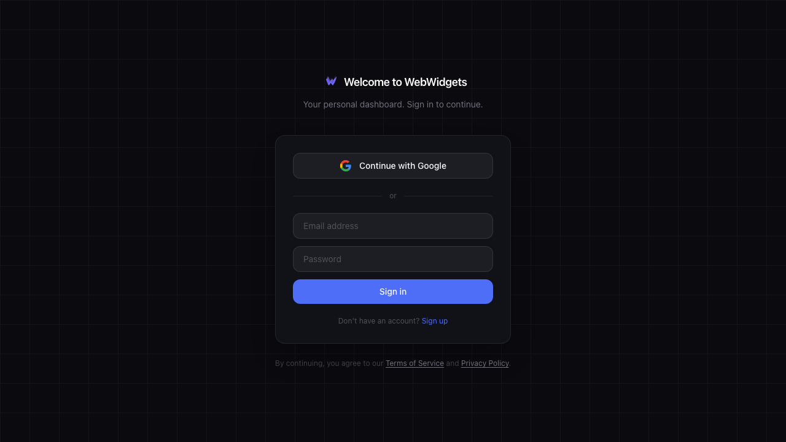
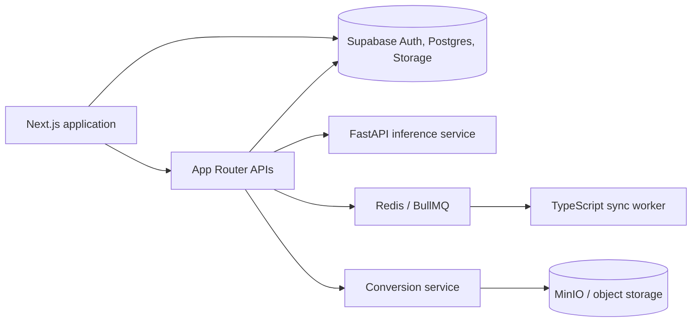

# WebWidgets

WebWidgets is a customizable personal workspace that brings planning, communication, finance, knowledge, and everyday tools into one persistent dashboard.

[**Live app: webwidgets.me**](https://webwidgets.me) · [Architecture](ARCHITECTURE.md) · [Roadmap](ROADMAP.md)



## Features

- Arrange reusable widgets across persistent dashboards, scenes, folders, and free-form layouts.
- Connect email, calendar, finance, files, research, reading, habits, recovery, and other personal workflows.
- Use a context graph to organize knowledge and control which memories and relationships features may access.
- Import and export user data through typed adapters and previewable conversion flows.
- Route long-running sync and automation work through background jobs with durable state and retry boundaries.
- Apply AI classification and suggestions through a separate, bounded inference service.

## Architecture



The Next.js application owns the product surface, authenticated APIs, and exact-payload approval boundaries. Supabase provides authentication, relational state, storage, and row-level security; privileged access is confined to server routes. Stateless ML work runs in a separate FastAPI service, while BullMQ workers handle scheduled and retryable jobs. The file-conversion subsystem is isolated behind its own API, queue, database, and object-storage boundary.

## Tech stack

- **Frontend:** Next.js 16, React 19, TypeScript, Tailwind CSS, dnd-kit, TipTap
- **Backend:** Next.js Route Handlers, FastAPI, Node.js workers, Fastify
- **Data:** Supabase PostgreSQL, Row Level Security, Realtime, Storage, Redis/BullMQ
- **Infrastructure:** Vercel, Render, Docker Compose, Sentry, PostHog
- **Testing:** Vitest, Playwright, Pytest, ESLint, custom type/smell checks

## Engineering highlights

- **Defense-in-depth data isolation.** Client reads use the Supabase anonymous client and RLS; service-role access stays in server-only API routes.
- **Bounded inference.** Classification and suggestion workloads run outside the web process so provider failures degrade individual features instead of the dashboard runtime.
- **Durable background work.** PostgreSQL owns lifecycle truth while BullMQ owns delivery, concurrency, retry timing, and delayed execution.
- **Adapter-driven portability.** Import/export capabilities normalize feature data behind typed adapters, allowing validation and previews before writes occur.
- **Feature boundaries at scale.** More than 60 feature modules are isolated from one another; shared dependencies flow through a deliberately small `lib/` surface.

## Testing

```sh
npm test                 # Vitest unit suite
npm run test:e2e         # Playwright browser suite
npm run check            # ESLint, TypeScript, code-smell checks, repository stats
npm run py:test          # FastAPI service tests
```

The automated suite covers widget persistence and runtime behavior, API authorization, import/export coercion, provider failure handling, job execution, and critical browser journeys.

## Running locally

### Prerequisites

- Node.js and npm
- Supabase CLI
- Docker for the full local service topology
- Python for the optional ML service

```sh
npm install
cp apps/web/.env.example apps/web/.env.local
supabase start
npm run dev
```

For the web app plus supporting services, use `npm run dev:full`. The ML sidecar runs separately with `npm run dev:ml`. See [docs/agents/workflow/CLI.md](docs/agents/workflow/CLI.md) for the broader command reference.

## Status and next steps

WebWidgets is live and under active development. The core dashboard and feature catalog are usable; production hardening remains for the continuously running worker topology and the standalone conversion service. Repository-wide lint and type debt is tracked openly and is being reduced incrementally.

**Demo video:** TODO — add a short authenticated product walkthrough.

Development has been AI-assisted; architecture, security boundaries, and shipped behavior are reviewed and tested by the project owner.

## License

Licensed under the [MIT License](LICENSE).
