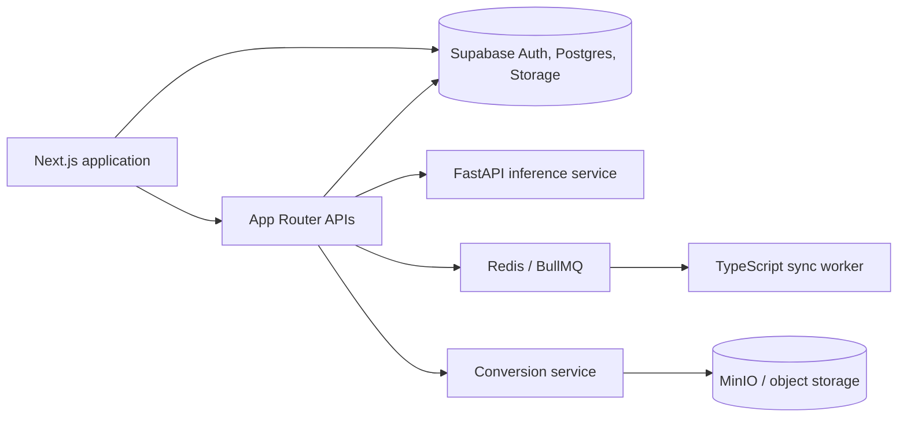

# WebWidgets

WebWidgets is a customizable personal workspace that brings planning, communication, finance, knowledge, and everyday tools into one persistent dashboard.

[**Live app: webwidgets.me**](https://webwidgets.me) · [Architecture](ARCHITECTURE.md) · [Roadmap](ROADMAP.md)


## Features

- Arrange reusable widgets across persistent dashboards, scenes, folders, and free-form layouts.
- Connect email, calendar, finance, files, research, reading, habits, recovery, and other personal workflows.
- Use a context graph to organize knowledge and control which memories and relationships features may access.
- Import and export user data through typed adapters and previewable conversion flows.
- Route long-running sync and automation work through background jobs with durable state and retry boundaries.
- Apply AI classification and suggestions through a separate, bounded inference service.

## Architecture



The Next.js application owns the product surface, authenticated APIs, and exact-payload approval boundaries. Supabase provides authentication, relational state, storage, and row-level security; privileged access is confined to server routes. Stateless ML work runs in a separate FastAPI service, while BullMQ workers handle scheduled and retryable jobs. The file-conversion subsystem is isolated behind its own API, queue, database, and object-storage boundary.

## Tech stack

- **Frontend:** Next.js 16, React 19, TypeScript, Tailwind CSS, dnd-kit, TipTap
- **Backend:** Next.js Route Handlers, FastAPI, Node.js workers, Fastify
- **Data:** Supabase PostgreSQL, Row Level Security, Realtime, Storage, Redis/BullMQ
- **Infrastructure:** Vercel, Render, Docker Compose, Sentry, PostHog
- **Testing:** Vitest, Playwright, Pytest, ESLint, custom type/smell checks

## Engineering highlights

- **Defense-in-depth data isolation.** Row Level Security is enabled on every application table, and browser reads go through the anonymous key. Service-role access is confined to server-only code. OAuth and provider credentials are column-restricted, so browsers see only connection metadata.
- **Bounded inference.** Classification and suggestion workloads run outside the web process so provider failures degrade individual features instead of the dashboard runtime.
- **Durable background work.** PostgreSQL owns lifecycle truth while BullMQ owns delivery, concurrency, retry timing, and delayed execution.
- **Adapter-driven portability.** Import/export capabilities normalize feature data behind typed adapters, allowing validation and previews before writes occur.
- **Feature modules at scale.** 71 domain feature modules live under `features/`, and shared code belongs in `lib/`. Some cross-feature imports remain and are being reduced toward that boundary.

## Testing

```sh
npm test                 # Vitest unit suite
npm run test:e2e         # Playwright browser suite
npm run check            # ESLint, TypeScript, code-smell checks, repository stats
npm run py:test          # FastAPI service tests
```

The Vitest suite has 525 passing unit tests. Alongside it are pytest suites for the ML service, conversion-service and sync-worker tests, pgTAP tests for RLS and credential boundaries, and Playwright journeys. Together they cover widget persistence and runtime behavior, API authorization, import/export coercion, provider failure handling, job execution, and critical browser flows.

## Running locally

### Prerequisites

- Node.js and npm
- Supabase CLI
- Docker for the full local service topology
- Python for the optional ML service

```sh
npm install
cp apps/web/.env.example apps/web/.env.local
supabase start
npm run dev
```

For the web app plus supporting services, use `npm run dev:full`. The ML sidecar runs separately with `npm run dev:ml`. See [docs/agents/workflow/CLI.md](docs/agents/workflow/CLI.md) for the broader command reference.

## Status

WebWidgets is live at [webwidgets.me](https://webwidgets.me) and in a monitored pilot. It is a personal project, not yet a production service for other people's data. [ROADMAP.md](ROADMAP.md) lists what remains before a V1 release.

- **Tests:** the 525 Vitest unit tests pass. CI also runs the pytest, conversion-service, and sync-worker suites; the pgTAP RLS tests run locally against Supabase.
- **Lint and type debt:** the repository-wide checker reports 540 ESLint errors, most of them `no-unsafe-*` from older untyped Supabase access, and 49 TypeScript errors. CI lints and type-checks only the files a change touches, so new code meets a clean bar while the backlog shrinks.
- **Why `main` shows a red scheduled run:** the *Daily lint report* workflow publishes the repository-wide numbers and deliberately exits non-zero while any debt remains. It will stay red until the backlog reaches zero. Pull-request checks gate new code.
- **AI features need your own key:** server-owned LLM keys are disabled until per-user quotas exist, so chat and email intelligence use keys users add in Settings.
- **Not yet production-hardened:** the continuously running worker topology, external alerting, and the standalone conversion service, which is not deployed.

**Demo video:** TODO — add a short authenticated product walkthrough.

Development has been AI-assisted; architecture, security boundaries, and shipped behavior are reviewed and tested by the project owner.

## License

Licensed under the [MIT License](LICENSE).
