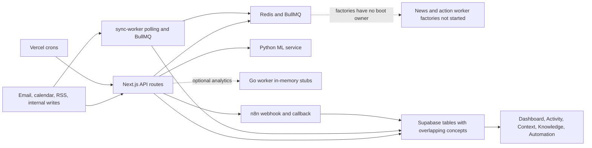
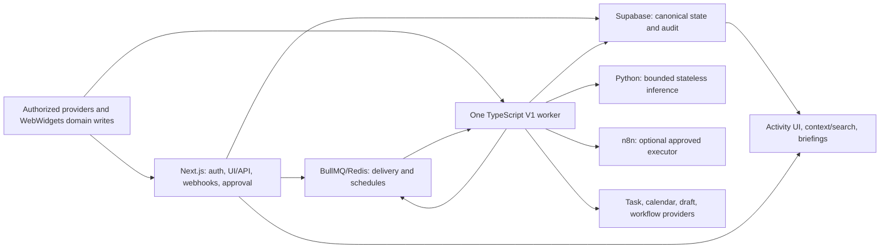
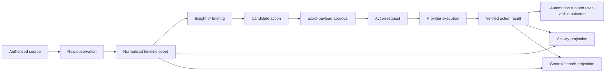

# V1 Runtime and Information Ownership Proposal

Status: Accepted

Prompt: 002

Last audited: 2026-08-13

Accepted by the project owner on 2026-08-13. ADR-008 through ADR-011 are
Active. This records ownership; it does not claim the target runtime or data
model has been implemented.

This document is the decision package for Prompt 002. It describes the
current conflicts, proposes one owner for every V1 runtime and record type,
and defines the migration boundary for later prompts. The target remains
implementation work for Prompts 003 onward.

## Executive decision

Use `services/sync-worker` as the foundation for the one durable V1
TypeScript/BullMQ worker. Supabase Postgres is durable product truth; Redis
and BullMQ deliver and schedule work but are never the only record that work
happened. Next.js owns authenticated UI/API, webhook validation, and exact
approval boundaries. Python performs bounded, stateless inference. n8n is an
optional, approved workflow executor. The Go worker is disabled for V1.

For information ownership, preserve domain records and `knowledge_items` as
their own source truth, introduce a normalized personal timeline for facts,
and treat activity and context as one-way, rebuildable projections. Reuse and
evolve the existing action, job, and automation records after the live-schema
audit instead of creating parallel lifecycle stores.

## Evidence from the current repository

- Root Vercel cron configuration invokes Gmail and Outlook processors, while
  `services/sync-worker` independently schedules account polling. Gmail also
  has webhook and polling-fallback paths. These can process the same source
  through different queues and snapshots.
- The sync worker has a real boot entrypoint, BullMQ scheduling, token refresh,
  retries, and graceful shutdown, but no repository-backed production host is
  selected.
- News and action worker factories exist but no process starts them. RSS jobs
  return in-memory items, `/api/news/feed` returns an empty result, and action
  jobs can be reported as deferred without a running consumer.
- Generic `jobs` runners execute synchronously inside a Next.js request. n8n
  callbacks create a new completed job instead of reliably correlating with
  and transitioning the originating job.
- The Go worker writes to in-memory channels and logs TODOs; it has no durable
  product state. Its analytics caller is feature-flagged off by default.
- The generated Supabase types contain `activity_events`, `context_entries`,
  `knowledge_items`, `jobs`, `action_requests`, `action_results`, and
  automation tables. Code also uses email tables absent from those types.
  Prompt 003 must verify the live database before any schema decision lands.
- Activity records are mutable notification/UI records with archive and prune
  behavior. Context is a mutable retrieval/entity graph backfilled from many
  features. Knowledge contains user-authored durable content. None can safely
  stand in for the other two or for a replayable event timeline.

## Current-state topology

The problem is not the number of languages. It is the absence of one durable
owner for scheduling, processing, and lifecycle transitions, plus the lack of
a one-way relationship between source truth, timeline, activity, and context.

## Target V1 topology

The worker is one deployed process, not necessarily one OS thread. It may run
multiple named BullMQ processors with bounded concurrency. All processors use
the same lifecycle contracts, correlation IDs, health reporting, and
deployment owner.

## Target lifecycle

Every transition persists its durable status before acknowledging queue
delivery. Models may create typed derived records or abstain; they cannot
approve, schedule, or invoke provider actions. The approval record binds the
action type, account, target, parameters, and payload version or hash.

## Runtime responsibility matrix

| Runtime | V1 ownership | Explicitly does not own |
| --- | --- | --- |
| Next.js | Authenticated UI/API, source configuration, webhook validation, short domain writes, timeline queries, exact-payload approval | Long loops, recurring schedules, retry orchestration, provider action processing |
| V1 TypeScript worker | Polling, normalization, analysis jobs, schedules, action execution, retries/dead letters, heartbeat | UI, interactive authentication, canonical data outside Supabase |
| BullMQ/Redis | Work delivery, delayed jobs, concurrency, retry timing | Product truth, final run status, approval, provider outcomes |
| Supabase Postgres | User scope, source cursors/health, canonical records, lifecycle state, provenance, audit | Running background loops |
| Python ML service | Versioned, bounded classification/extraction/inference requests | Scheduling, queues, authorization policy, durable state, provider actions |
| n8n | Optional execution adapter for an explicitly configured and approved workflow | Ingestion owner, scheduler of record, approval state machine, canonical job history |
| Go worker | Deferred and disabled for V1 | Any required ingestion, analytics, snapshot, event, or action path |
| Conversion service | Specialized file conversion behind its existing contract | General V1 orchestration or timeline ownership |
| Vercel cron | Temporary migration fallback only | A schedule also owned by the worker after cutover |
| Dashboard runtime | Hydration, rendering, local UI state | Durable ingestion, analysis, scheduling, or execution |

### Production deployment responsibility

- Deploy Next.js using the existing web deployment path.
- Deploy `services/sync-worker` as one continuously running container with
  Redis and Supabase connectivity. Prompt 005 must select the concrete host,
  document rollout/rollback, and prove readiness before removing cron
  fallbacks.
- Deploy Python as a private or authenticated container endpoint reachable by
  the worker. Existing Python Vercel manifests are legacy candidates until
  Prompt 005/010 establishes one supported path.
- Do not deploy Go for V1. n8n and conversion remain separately operated
  adapters with health and timeout boundaries.

## Information responsibility matrix

| Concept | V1 role and owner | Source of truth? | Important boundary |
| --- | --- | --- | --- |
| Provider/domain records | Current provider or WebWidgets domain state | Yes | Keep existing task, calendar, document, note, and provider identity rather than copying whole objects |
| Source connection | Authorization reference, cursor, consent, and health | Yes | Adapt existing integration/account tables after Prompt 003 verifies the live schema |
| Raw observation | Minimal immutable ingestion evidence, provider reference, hash, and receive metadata | Yes, for ingestion/replay window | New canonical concept; private payload is minimized and short-lived |
| Timeline event | Normalized, user-scoped fact with occurrence time and provenance | Yes, for V1 event history | New canonical concept; activity cannot substitute for it |
| `activity_events` | Notification and recent-activity UI projection | No | May be archived/pruned and must never feed the timeline back into itself |
| `knowledge_items` | User-authored notes, journals, drafts, transcripts, and research content | Yes, for authored content | Timeline stores lifecycle facts/references, not duplicated bodies |
| `context_entries` / edges | Entity and retrieval projection for search, widgets, and models | No | Rebuildable; cannot be the event log or outlive its source |
| Insight/briefing | Evidence-linked, expiring derived interpretation | No | Must identify source timeline events, model/policy version, confidence or abstention |
| Candidate action | Evidence-linked proposal before approval | No | Replace/converge legacy email-only candidates; it cannot execute itself |
| Approval | Immutable decision for one exact action payload/version | Yes | Invalidated by payload, permission, account, or policy changes |
| `action_requests` | Durable command and execution lifecycle | Yes | Reuse/evolve after Prompt 003; do not create a parallel request ledger |
| `action_results` | Verified provider receipt, failure, and compensation state | Yes | Reuse/evolve after Prompt 003; a queued acknowledgement is not success |
| `jobs` / steps | Operational correlation and persisted worker status | Yes, for operations | BullMQ ID references the job; Redis history does not replace it |
| Automation config/run | Policy configuration and orchestration of typed actions | Yes, for automation | Runs reference action requests/results rather than copying provider outcome truth |
| Audit/security record | Content-minimized consent, permission, and security evidence | Yes | Not a user timeline or model-context source |

## Why the competing candidates cannot be canonical

| Candidate | What breaks if it becomes the owner |
| --- | --- |
| `activity_events` as timeline | Existing pruning loses history; read/archive mutations change truth; notification publishers can create feedback loops; provenance and idempotency are incomplete |
| Context as timeline or knowledge | Backfills and entity upserts rewrite history; deletion/rebuild behavior becomes unsafe; retrieval summaries can be mistaken for source content |
| Knowledge as timeline | It represents authored content, not provider changes, task transitions, action receipts, or source health |
| Next.js/Vercel cron as worker | Request time limits, overlapping schedules, and deploy restarts make durable retries and continuous work unreliable |
| n8n as orchestrator of record | Current callbacks do not reliably transition the originating job; user scope, approval, policy, and replay become split across systems |
| Go as worker | Current state is in-memory and stubbed, so restart loses work and required processors do not exist |
| BullMQ as product truth | Queue cleanup, Redis loss, or retry changes erase the only record of intent and outcome |
| Multiple source-specific workers | Email, RSS, actions, and automation acquire different lifecycle rules, deployment health, and duplicate schedules |

Selecting the existing sync worker still requires substantial work: its name
is narrower than its target role, it currently knows only email polling, its
production host is unspecified, and other factories must be moved behind its
entrypoint. It is selected because it already has the strongest durable-worker
foundation, not because it is finished.

## Replay, retention, and deletion proposal

These are proposed V1 defaults and require human acceptance with the ADRs.

### Replay and idempotency

- Ingestion identity is scoped by `user_id`, source connection, provider
  object/event ID, logical event type, and provider version or content hash.
- A redelivered webhook, cursor overlap, or polling overlap coalesces into the
  same logical observation/event. A meaningful later state transition creates
  a new event; a provider correction updates the same event revision and
  preserves provenance.
- Queue jobs carry the canonical record ID and deterministic idempotency key.
  A worker restart may deliver more than once, but domain effects remain once
  from the product's perspective.
- Derived records include input IDs and analyzer/policy version so they can be
  reproduced or invalidated without silently replacing user-visible history.

### Proposed retention defaults

| Record | Default V1 retention |
| --- | --- |
| Raw private payload | Delete within 30 days after successful normalization; retain only minimized reference/hash metadata needed for provenance and dedupe |
| Timeline event | 365 days unless the user deletes it or removes imported source data |
| Activity projection | Archive read events after 30 days and delete archived events after 90 days, matching current behavior |
| Context projection | Never longer than its source; rebuild or delete when the source changes or is removed |
| Knowledge/domain content | Until user deletion or the owning feature's explicit retention rule |
| Insight/candidate | Until expiry or dismissal, then delete content within 30 days while retaining a minimized status receipt |
| Job logs and successful operational detail | 30 days; failed/dead-letter diagnostic metadata up to 90 days |
| Approval, action request/result, automation outcome | Content-minimized record for 365 days, subject to account deletion |

### Disconnect and deletion

- Disconnect immediately disables new schedules, rejects queued work at the
  pre-execution permission check, and revokes or deletes refresh credentials.
- Disconnect preserves normalized timeline history by default so a user does
  not lose their record accidentally. The disconnect flow must offer removal
  of imported source data.
- Removing imported source data deletes raw payloads and source-owned timeline
  events, then cascades or invalidates dependent insights, candidates, context,
  and pending actions. Retain only an opaque deletion/audit receipt without
  private content.
- Provider deletion/cancellation signals remove stored private payload and
  tombstone or delete the related fact according to the provider contract.
- Account deletion removes all user-owned source, timeline, knowledge,
  projection, approval, execution, automation, and audit content under the
  account-deletion policy.

## Migration strategy

1. **Approve the boundaries.** A human accepts or revises ADR-008 through
   ADR-011. Only then update `ARCHITECTURE.md` and unblock Prompt 004.
2. **Audit live state.** Prompt 003 inventories the actual Supabase schema,
   RLS, generated-type drift, production schedules, and data volumes. It maps
   existing integration, email, action, job, and automation records to this
   model.
3. **Add contracts additively.** Prompt 004 creates only missing canonical
   concepts and relations. It reuses/evolves `action_requests`,
   `action_results`, `jobs`, and automation records where safe. No old table is
   dropped during the initial migration.
4. **Deploy the worker dark.** Prompt 005 extends the sync-worker entrypoint,
   adds health/dead-letter behavior, and deploys processors disabled or in
   shadow/dry-run mode. Supabase records remain the observable truth.
5. **Cut over one source at a time.** RSS, email/calendar, then internal
   sources write idempotent timeline records. Compare duplicates, latency, and
   source health before disabling the corresponding legacy cron/processor.
6. **Project one way.** Activity and context consume canonical domain,
   timeline, and outcome records through origin-marked projectors. They never
   republish their own projections as new facts.
7. **Converge actions and automation.** Move legacy `email_actions`, n8n
   callbacks, and synchronous jobs onto the unified candidate/approval/action
   lifecycle. Preserve compatibility reads until regression tests and
   backfills prove cutover.
8. **Retire duplicates.** Remove Vercel schedules, undispatched worker
   factories, legacy callback behavior, and obsolete tables only in later,
   reversible changes with measured parity and rollback notes.

## Approval record

The project owner accepted these five points on 2026-08-13:

1. `services/sync-worker` becomes the one continuous V1 worker foundation.
2. Supabase is truth and BullMQ/Redis is delivery; Next.js, Python, n8n, Go,
   conversion, and Vercel cron have the bounded roles above.
3. Timeline is a new canonical event concept; activity and context are
   projections; knowledge and domain objects retain their own source truth.
4. Existing action/job/automation tables are reused or evolved after the live
   audit instead of duplicating ledgers.
5. The replay, 30/90/365-day retention, disconnect, and cascading deletion
   defaults are acceptable for V1.

Prompt 002 is complete and ADR-008 through ADR-011 are Active. Prompt 004
remains blocked on Prompt 003's live-schema and RLS audit.
